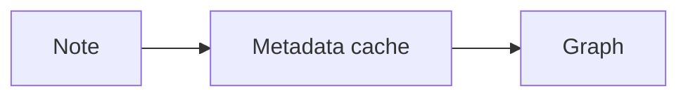

Use fenced code blocks when whitespace, syntax, or exact text matters.

````markdown
```ts
export function title(text: string) {
  return text.trim();
}
```
````

Lapis renders ordinary code fences in notes with syntax highlighting, a language
label, and a copy button. Some fenced blocks also have special meaning in the
app.

## Inline code

Wrap short code fragments in single backticks: ``Use the `status` field``.

To include a backtick inside inline code, wrap the fragment in double backticks:
`` `code` ``.

## Fenced code blocks

Open and close a block with three or more backticks or tildes. Add an optional
language identifier after the opening fence for highlighting:

````markdown
```python
print("Hello")
```
````

You can also indent a block by four spaces or use `~~~` tildes instead of
backticks.

### Nested fences

When documenting code that contains fences, use more backticks on the outer
block than on any inner block:

`````markdown
````md
```js
console.log("nested");
```
````
`````

## Reading mode features

In reading mode, code blocks show:

- Syntax highlighting via the active theme
- A language label when a language is specified
- A copy-to-clipboard button

## Math

Lapis supports inline and block LaTeX math in notes.

```markdown
Inline math: $E = mc^2$

Block dollar math:

$$
\sum_{n=1}^{5} n = 15
$$

Inline bracket math: \(a^2 + b^2 = c^2\)

Block bracket math:

\[
\int_0^1 x^2 \, dx
\]
```

Both `$...$` / `$$...$$` and `\(...\)` / `\[...\]` forms work in source and
reading mode.

## Mermaid diagrams

Use Mermaid fences when a note needs a lightweight diagram.

````markdown

````

## Plugin-aware fences

Some plugins use fenced blocks as inputs to richer features. For example,
search can render `query` blocks, and notebook documents use their own cell
syntax for executable content.

## Use the right tool for the job

- Use ordinary code fences for source, config, commands, and snippets.
- Use math blocks when the note needs readable equations.
- Use Mermaid when a quick diagram belongs inside the note itself.
- Use notebook documents when the work needs executable cells rather than a
  static fenced block. Start with
  [Getting started with notebooks](/help/plugins/notebook/getting-started/).

## Related pages

- [Basic formatting](/help/editing/basic-formatting/)
- [Markdown basics](/help/editing/markdown-basics/)
- [Notebook overview](/help/plugins/notebook/)
- [Cells and syntax](/help/plugins/notebook/cells-and-syntax/)
- [Slides](/help/plugins/slides/)
